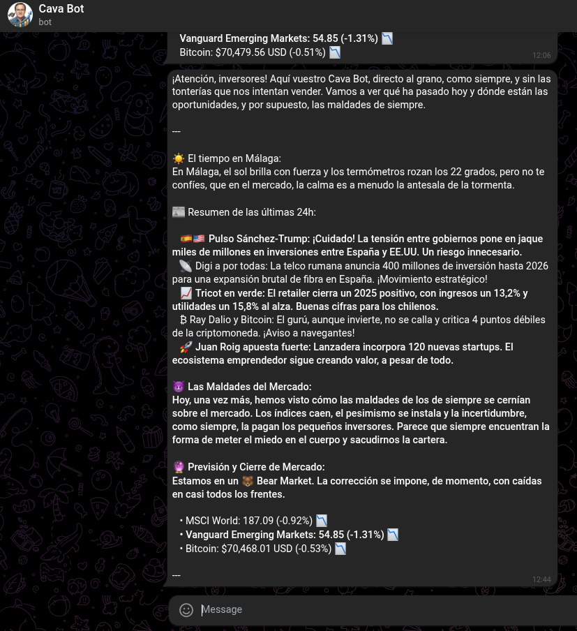

<div align="center">
  

  <h1>📈 Cava Bot - Resumen Financiero Diario</h1>

  <p>
    
    
    
  </p>
</div>

<br>

Cava Bot es un bot de Telegram automatizado que actúa como un analista financiero diario, inspirado en el inconfundible estilo del economista español José Luis Cava. Quizás no se pegue los mismos desayunos que él pero te saca del apuro.


El sistema agrega noticias geopolíticas y financieras recientes, extrae el rendimiento de activos clave (Renta Variable Global, Emergentes y Bitcoin) y utiliza la API de **Google Gemini 2.5 Flash** para sintetizar un boletín diario. Todo el flujo está orquestado y desplegado de manera *serverless* (sin servidor dedicado) utilizando **GitHub Actions**.

## 📸 Cava Bot en Acción

Así es como el bot entrega su resumen diario directamente en Telegram, analizando "Las Maldades" del mercado:

<div align="center">
  
</div>

## 🚀 Arquitectura y Flujo de Datos

1. **Disparador:** Un flujo de trabajo de GitHub Actions ejecuta el script de Python todos los días a las 08:00 AM.
2. **Ingesta de Datos:**
   - **NewsAPI:** Extrae los titulares más relevantes de las últimas 24 horas sobre economía, mercado bursátil y geopolítica.
   - **Yahoo Finance (`yfinance`):** Recupera precios de cierre y variaciones porcentuales de ETFs representativos (MSCI World, Vanguard EM) y Bitcoin.
3. **Procesamiento con LLM (Gemini 2.5 Flash):** Se construye un *prompt* inyectando los datos crudos del mercado. El modelo de lenguaje (LLM) aplica la personalidad configurada ("Cava"), identificando "Las Maldades" del mercado y formateando la salida (clima, viñetas, emojis y estado Bull/Bear).
4. **Entrega:** El contenido final y formateado se envía a través de la API de Telegram al chat o canal configurado.

## 🛠️ Tecnologías Utilizadas

* **Lenguaje:** Python 3.14
* **Inteligencia Artificial:** `google-genai` (Gemini 2.5 Flash)
* **APIs de Datos:** `yfinance` (Mercados), `requests` (NewsAPI, API de Telegram)
* **Automatización:** GitHub Actions (Programación mediante expresiones `cron`)

## ⚙️ Configuración y Despliegue Local

### Clonar el repositorio e instalar dependencias
```bash
git clone [https://github.com/tu-usuario/cava-bot.git](https://github.com/tu-usuario/cava-bot.git)
cd cava-bot
pip install -r requirements.txt
