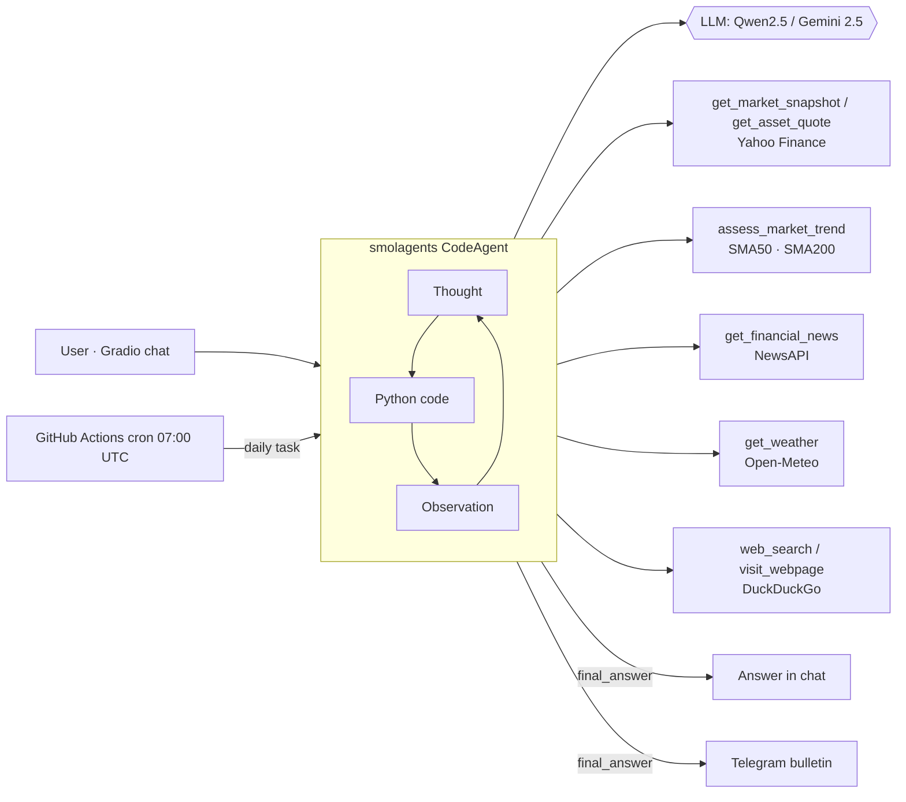

<div align="center">
  

  <h1>📈 Cava Agent — AI Financial Analyst Agent</h1>

  <p>
    
    
    
    
    
  </p>

  <p>
    <a href="#-español">🇪🇸 Leer en español</a>
  </p>
</div>

---

## 🇬🇧 English

**Cava Agent** is an autonomous AI agent that works as a daily financial analyst, with the blunt style of the Spanish economist José Luis Cava (and his famous *"las maldades"* of the market).

It was built as the **Unit 1 project of the [Hugging Face Agents Course](https://huggingface.co/learn/agents-course)**, starting from the course's `First_agent_template` and evolving my previous project, a fixed LLM pipeline, into a real agent.

### From pipeline to agent

| | v1 – Cava Bot ([`legacy/cava_bot.py`](legacy/cava_bot.py)) | v2 – Cava Agent |
|---|---|---|
| Control flow | Hard-coded: fetch news → fetch prices → 1 prompt | The LLM **plans and decides** which tools to call (ReAct loop: Thought → Code → Observation) |
| Interaction | Only a daily Telegram message | Interactive chat (Gradio) **and** the daily Telegram bulletin |
| Weather | Generated by the LLM (unverified) | Real data from Open-Meteo |
| Bull / Bear | LLM opinion | Computed: price vs. SMA50/SMA200, golden/death cross, drawdown |
| Assets | 3 fixed tickers | Any Yahoo Finance ticker, any period |
| LLM | Gemini only | Pluggable: Gemini 2.5 Flash (LiteLLM) or Qwen2.5-Coder-32B (HF Inference) |

### Architecture



### Tools

| Tool | What it does | Source |
|---|---|---|
| `get_market_snapshot` | Close and daily change of MSCI World (URTH), Vanguard EM (VWO) and Bitcoin | Yahoo Finance |
| `get_asset_quote` | Close, daily and period change for any ticker (`^GSPC`, `^IBEX`, `AAPL`, `EURUSD=X`…) | Yahoo Finance |
| `assess_market_trend` | Bull / Bear / sideways classification from SMA50/SMA200 and 52-week drawdown | Yahoo Finance |
| `get_financial_news` | Most popular headlines of the last 24h for a topic | NewsAPI |
| `get_weather` | Current weather and today's min/max for a city | Open-Meteo |
| `get_current_time_in_timezone` | Local time in any timezone | pytz |
| `web_search` / `visit_webpage` | Web search and page reading as a fallback | DuckDuckGo |

The Telegram sender is **not** exposed as a tool: the chat UI is meant to be shared and anyone with access to the chat could use it to send messages.

### Project structure

```
app.py               # entry point: build_agent() + Gradio chat UI
agent.py             # model selection, tools and prompts → CodeAgent
daily_bulletin.py    # daily task for the cron job → Telegram (DRY_RUN=1 prints it)
prompts.yaml         # smolagents prompts + Cava persona
tools/               # custom tools
telegram_client.py   # Telegram Bot API client
legacy/cava_bot.py   # v1 (pipeline version)
```

### Run locally

```bash
git clone https://github.com/rgallegocode/cava-bot.git
cd cava-bot
pip install -r requirements.txt gradio

cp .env.example .env         # fill in your keys (.env is git-ignored)

python app.py                          # chat UI
DRY_RUN=1 python daily_bulletin.py     # print today's bulletin
```

| Variable | Used by | Description |
|---|---|---|
| `MODEL_PROVIDER` | all | `gemini` (default) or `hf` |
| `HF_TOKEN` | hf model | Hugging Face token (only for `MODEL_PROVIDER=hf`) |
| `GEMINI_API_KEY` | gemini model | Google AI Studio key |
| `NEWS_API_KEY` | `get_financial_news` | newsapi.org key |
| `TELEGRAM_TOKEN`, `CHAT_ID` | `daily_bulletin.py` | Telegram bot and chat |

### Automation (GitHub Actions)

- **`.github/workflows/main.yml`**: every day at 07:00 UTC the agent researches the market and posts the bulletin to Telegram. API keys are stored as GitHub Secrets; run it manually with *dry run* to see the bulletin in the job log without sending it.

> **Disclaimer:** Cava Agent output is for informational purposes only and does not constitute financial advice.

## 📸 Cava Bot in action

<div align="center">
  
</div>

---

## 🇪🇸 Español

**Cava Agent** es un agente de IA autónomo que actúa como analista financiero diario con el estilo directo del economista José Luis Cava y sus famosas *"maldades"* del mercado.

Es el **proyecto de la Unidad 1 del [Hugging Face Agents Course](https://huggingface.co/learn/agents-course)**: parte del `First_agent_template` del curso y convierte mi proyecto anterior, un pipeline fijo con un LLM, en un agente de verdad.

### Qué cambia respecto a la v1

- **El LLM decide**: un `CodeAgent` de smolagents razona en ciclos *Pensamiento → Código → Observación* y elige qué herramientas usar según la pregunta.
- **Chat interactivo** (Gradio), además del **boletín diario** en Telegram, que ahora también genera el agente.
- **Cero datos inventados**: el tiempo sale de Open-Meteo y el Bull/Bear se calcula con las medias móviles de 50 y 200 sesiones, ya no es una opinión del LLM.
- **Cualquier activo**: cualquier ticker de Yahoo Finance y cualquier periodo.
- **LLM intercambiable**: Gemini 2.5 Flash o Qwen2.5-Coder-32B (HF Inference) con la variable `MODEL_PROVIDER`.

### Preguntas de ejemplo

- "Dame el resumen del mercado de hoy y las maldades de la jornada"
- "¿Estamos en bull o bear market con el S&P 500?"
- "¿Cómo ha ido Bitcoin el último mes y qué noticias lo explican?"

La arquitectura, las herramientas y las instrucciones de instalación están en la [sección en inglés](#-english).

> **Aviso legal:** el contenido generado por Cava Agent es informativo y no constituye asesoramiento financiero.
